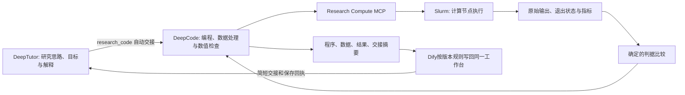

# DeepTutor 的科研计算与评估接入

本模块已将现有 DeepTutor、DeepCode、Slurm 和 openPASO 连接起来。Tutor 根据对话和资料提出研究思路、解释目标并作研究判断；DeepCode 负责编程、数据处理、计算检查和技术产物整理；MCP 提供真实计算动作与记录；技能规定怎样形成有区分力的检验。Code 的显式产物清单自动经现有 Dify 交付流程写回同一研究工作台，Tutor 先读交接摘要，需要时再定向读取文件。

## 已找到的现有能力

| 能力 | 实际位置或状态 | 本次判断 |
|---|---|---|
| DeepTutor | 本机 `C:/Users/DEVELOPER/DeepTutor`；服务器 1.7.0 | Tool 与 Capability 支持代码执行、MCP 和编码扩展。L1/L2/L3 是记忆层次，L3 不限制编程。 |
| DeepCode | 本地源码 `D:/Development/skill开发/outputs/codex-research-learning-20261029/deepcode-source`；服务器 2.3.1 | 已通过 `tutor_deepcode` 0.2.1 接入 `coder_run`、`code_files` 和代码模式，保留原生 Session/Turn。 |
| openPASO | `/work/home/cluster_user/opensource/openpaso` | 真实 MCP 初始化和 tools/list 返回 25 工具；本次在 Slurm 中记录完整 schema。未重测全部后端。 |
| 集群计算 | SSH `research-cluster-xh5`，账号 cluster_user，CPU 分区 xhacnormalb | 本机身份可用；原服务器 coder 的旧 SSH 身份认证失败。本模块使用单独身份连接新计算入口。 |
| 科学编程技能 | `C:/Users/DEVELOPER/.agents/skills/focused-research-engineering`、`remote-research-cluster`、`openpaso-simulation` | 已存在，并且 DeepCode 的技能目录也已有这些技能。 |
| 数值验证技能 | `C:/Users/DEVELOPER/.codex/skills/simulation-result-validation`；`D:/Development/询问/physics-code-engineering` | 复用其区分软件执行、数值正确性与用途有效性的原则。 |

当前 Codex 主配置中的已配置 MCP 主要是 node_repl、scansci-pdf、illustrator 和 research-workbench；openPASO 的既有原生注册在 `D:/Pi/Data/.agents/servers/openpaso-cluster.json`。配置存在、连接成功和真正完成求解分开核验。

## 为什么采用 MCP 加技能，复用已有 Agent

MCP 负责真实动作与记录：固定输入、提交 Slurm、查询终态、读回文件、应用预先声明的数值判据。它不需要另一套模型密钥，也不替用户决定研究结论。

Tutor 负责研究对话、动机、路线选择和研究解释。Code 负责实现算法、处理数据、建立有依据的基准、执行检查、说明计算偏差并整理交接。两者仍可按需要阅读资料和推理，差异在主要职责与可用动作；不要求 Tutor 在每次交接后重新执行完整验证。`research-compute-validation` 把这些行为连接起来。

实际工作流：



## 接口

Tutor 当前默认注册原生工具 `research_code`：`plan` 只规划，`code` 委托实现并发布交接，`status` 查询同一任务并恢复已完成任务的交接发布，`cancel` 取消同一任务。发布未确认时保留任务号，避免重复实施。工具自动交接当前研究项目规范、文件清单、有限相关文本及对话，保留 DeepCode 原生 Session/Turn 和途中提问。无需用户先手动切换代码模式。

DeepCode 中通过其官方 MCP client 注册 `research-compute`；`deepcode mcp test research-compute` 已通过，返回 1 工具。底层计算工具名为 `research_compute`，其动作见下表。原生 Tutor 计算适配器 `tutor_compute.py` 保留在源码中，默认流程将计算交给 Code。

| action | 行为 |
|---|---|
| inventory | 查询当前运行时、分区、association 和资源策略，不分配计算资源 |
| prepare | 固定一个实验的代码、输入、参照、数值判据和资源，返回 experiment_id |
| submit | 提交同一实验，记录真实 job_id，重复请求复用已有作业 |
| status | 查询 sacct 及执行回执，返回文件清单和远端位置 |
| read | 有限回读实验内的文本、JSON、CSV 或日志 |
| assess | 根据真实终态、进程退出与运行前判据生成 JSON/Markdown 评估 |
| cancel | 请求停止当前实验登记的作业，并返回是否已确认终态 |
| openpaso_schema | 读取一个实际 openpaso_catalog 作业记录的工具定义 |

`prepare` 的 spec 字段：

```json
{
  "question": "本次计算能区分的科学或数值问题",
  "runtime": "paso",
  "files": [{"path": "main.py", "content": "实际完整程序"}],
  "entrypoint": "main.py",
  "arguments": [],
  "criteria": [{"name": "解析误差", "metric": "l2_error", "op": "le", "threshold": 0.001, "unit": "1"}],
  "reference": {"type": "analytic", "description": "实际参照及其适用条件"},
  "limitations": ["未开展实验比较"],
  "resources": {"cpus": 2, "memory_mb": 4096, "minutes": 5}
}
```

程序在实验目录运行，将实测标量写成 `outputs/metrics.json`，格式为 `{"metrics":{"l2_error":0.0001}}`；原始表和场数据另存。该示例中的数值只是格式示例，真实验收见 reports。

支持现有 `python`、`paso`、`torch` 运行时及 `openpaso`、`openpaso_catalog`。当前正式策略为每作业 1–4 CPU、512–8192 MB、1–15 分钟；GPU、长训练、参数大扫描需要调整资源策略和研究计划。本轮未验证 GPU、训练或所有 openPASO 求解器。

## 部署和数据位置

- VPS 模块：`/srv/tutor-research-compute`，容器 `research-compute`，复用现有 coder 镜像，不改 DeepTutor/DeepCode 核心源码。
- MCP 地址：内部网络 `http://research-compute:47920/mcp`，主机仅绑定 `127.0.0.1:47920`，需私有令牌；未新增公开网页入口。
- 原生扩展：使用现有已挂载的 `/srv/dify-research/tutor-extension`；仅对管理员会话激活，身份由服务器绑定。
- DeepCode：用户级 MCP 配置引用 stdio 代理；令牌在私有用户目录，项目配置没有令牌正文。
- 集群控制程序：`/work/home/cluster_user/.local/share/tutor-research-compute`。
- 实验权威数据：`/work/home/cluster_user/research-projects/tutor-compute/<experiment_id>`，包含 experiment.json、job.sbatch、源码、logs、receipts、outputs。

为新连接设置了独立公钥及 authorized_keys 的来源/forced-command 选项。实际探测发现集群接入网关未落实 forced-command，不能把这些选项称作操作系统级隔离。当前范围和资源约束由 MCP 接口、应用管理员权限与 Slurm 执行；这是受信科研代码的运行通路，不是面向不可信程序的安全沙箱。既有本机私钥没有复制到服务器。

## 本次真实验收

采用一维无量纲变系数扩散制造解：

\[-((1+x)u')'=f,\quad u=\sin(\pi x),\quad f=\pi^2(1+x)\sin(\pi x)-\pi\cos(\pi x).\]

两端零 Dirichlet，P1 FEM，8/16/32/64 单元。正确实现使用散度形式；错误实现遗漏系数梯度，实际求解 `-k*u''=f`。两者使用完全相同的判据，执行前固定 L2 误差不超过 0.001、L2 收敛阶至少 1.8、线性相对残差不超过 1e-10、边界误差不超过 1e-14。

| 指标 | 正确实现 | 错误实现 |
|---|---:|---:|
| Slurm job | 25160791 | 25160812 |
| 退出状态 | COMPLETED / 0:0 | COMPLETED / 0:0 |
| 最细网格 L2 误差 | 0.00015376852795881754 | 0.037480959797449545 |
| 最小 L2 收敛阶 | 1.997024717203223 | 0.0016872581842754218 |
| 最大线性相对残差 | 7.102742976094558e-14 | 8.326440390545808e-14 |
| 边界误差 | 0 | 0 |
| 评估 | NUMERICALLY_CHECKED | FAILED |

错误实现的线性系统求解得很准确，但不满足目标方程的独立参照与收敛要求。这个反例说明退出码和小残差不能替代数值正确性。它只核验该光滑一维线性问题与接入通路，不支持复杂材料机制或实验有效性的结论。

openPASO 工具目录作业为 25160824，COMPLETED / 0:0，实际返回 25 工具，包括 run_simulation、verify_pde_consistency、verify_interface_flux、verify_mesh_independence 等；完整 schema 在对应远端目录和 reports/live-verification.json 中。目录发现不等于这些工具的所有功能均被测过。

已通过 7 项计算合同测试和 3 项 Tutor 身份绑定测试。真实验收覆盖 MCP 初始化、认证拒绝、同作业重复提交、正确数值接受、错误算子拒绝、真实工具 schema、原始结果与运行回执。

`assess` 读取的指标来自实验程序。MCP 不会独立证明该程序或数据真实无误，Agent 仍需审查参考独立性、测量映射、单位和对照。没有独立实验数据时，不把数值检查升级为实验验证。

## 在 Tutor 使用

刷新已有会话或新开会话，选择研究项目后可直接说：

> 请先根据我们讨论的研究目标提出一个有区分力的计算检验思路，然后交给 Code 实现和检查。让它按当前项目规范整理程序、数据、结果和交接说明，保存回这个工作台。你根据交接摘要解释结果，必要时再定向看原始文件，继续和我讨论研究。

Code 的正式交付按项目组织为 `src/`、`data/`、`results/`、`docs/`；只创建有实际用途的目录。`docs/code-handoff.md` 是 Tutor 的阅读入口，记录回答的问题、产物、实际指标、失败解释、来源和用途范围。`research-handoff.json` 将产物与当前真实任务号绑定，列出需要发布的文件。文本覆盖使用项目版本检查与可恢复历史；大型原始场留在集群，以来源清单关联。

DeepCode 原生的根目录 `verification.json` 和 `research-handoff.json` 如被显式列入交付清单，发布时分别归入工作台 `docs/`，保持四类正式目录。交接摘要默认要求简短；如超出工具摘要长度，返回截断标识，并始终单独返回完整验证与局限字段，Tutor 可按文件路径继续读原文。

Tutor 可复用已有原生 `workspace_list`、`workspace_read` 和 `workspace_search`；工作区路径以 `project/` 开头。例如用 `workspace_read(path="project/docs/code-handoff.md")` 回读说明，用 `workspace_search(query="l2_error", path="project/")` 定向查找指标。不新增第二套文件读取或检索服务。

项目输入自动交接有范围上限：最多枚举250文件，默认优先交接40个小型文本/代码文件，总量不超过6MB；明确指定的路径排在前面。工具返回已复制与遗漏清单，Code 不能把未读取的资料当作已知。超过范围的任务应显式指定相关路径或使用原有代码模式处理完整仓库。

当前发布器支持文本成果的版本化替换和新二进制文件的上传；已有二进制成果的替换尚未连接到工作台版本化上传接口，遇到时保留原文件并报告具体未完成项。此次真实交接验收使用程序、CSV、JSON 和 Markdown。

已创建“计算验证能力验收”项目用于本次接入验收。生产研究应使用真实问题自己的项目与资料，先查询既有实验，不重复提交已运行的算例。

## 来源

- DeepTutor 官方 v1.7.0 README：https://github.com/HKUDS/DeepTutor/blob/v1.7.0/README.md
- DeepCode 官方 v2.3.1 MCP 服务实现：https://github.com/HKUDS/DeepCode/blob/v2.3.1/cli/mcp_server.py
- openPASO 官方仓库：https://github.com/open-PASO/openPASO
- 本次数值源码复用本机 physics-code-engineering/scripts/manufactured_diffusion.py。

## 早期计算接口验收

已通过原生 WebSocket 会话验证，实际调用 read_skill、research_compute 和 research_workbench，回读两份原始收敛 CSV，形成有条件的科学解释，并经 Dify 保存和回读报告。

https://tutor.example.invalid/chat/unified_1793538288648_65d02bd9?dt_workspace=ws_f96bbe8cc54e4676bb821def0e102eff

工作台项目：计算验证能力验收；项目 ID `50313863a9544f72aae778d7381bfe79`，产物 `project/docs/numerical-validation.md`。本地副本在 `reports/DeepTutor计算验收报告.md`，完整实际回执在 `reports/agent-verification.json`。

## 最新职责交接验收

当前默认分工已通过真实会话验证：Tutor 先说明研究目的，经 `research_code` 委托原生 DeepCode；Code 通过计算 MCP 回读既有正确/错误实验的原始收敛表，编写并实际运行 `src/check_convergence.py`，六项针对行为的软件测试通过。复算不使用 CSV 原有的预计算阶；正确实现最小 L2 阶为 1.997024717203223，错误实现为 0.0016872581842754218。只读原实验并处理小表，没有新建或重算 Slurm 作业。

实际写回同一工作台的 11 项成果：`src/check_convergence.py`、`src/test_check_convergence.py`、两份 `data/*_convergence.csv`、`data/source-manifest.json`、`data/source-evidence.json`、`results/comparison.json`、`results/validation.json`、`results/verification.json`、`docs/code-handoff.md`、`docs/research-handoff.json`。每项都有 `saved` 回执，并已通过工作台接口回读。

第一次交接暴露了原生根目录元数据与工作台四类目录的路径冲突。保留已有科学程序与结果后修正发布目录，并在接口中兼容两种原生元数据文件的归档。五项交接测试通过；`status` 可以沿用已完成任务继续发布，不另行启动计算。实际完成任务号为 `7be92c852bf5943fe4439bc0`。

重启 Tutor 后，在同一会话实际调用 `research_code(status)`，确认同任务 11 份保存回执仍可查询；随后调用 `workspace_search` 在 `project/` 内检索，再用 `workspace_read` 读取 `project/results/comparison.json` 并解释。该轮没有再次委派实施或调用计算。交接说明里的“待发布”是 Code 生成时的状态，后续真实保存回执是当前发布状态的依据。

会话：https://tutor.example.invalid/chat/unified_1793539089602_c6e01990?dt_workspace=ws_f96bbe8cc54e4676bb821def0e102eff

实际回执保存在 `reports/delegation-agent-verification.json` 与 `reports/retrieval-agent-verification.json`。此次核验支持软件协作与这一个制造解上的数值检查，未证明所有求解器、真实材料机制或实验有效性。
