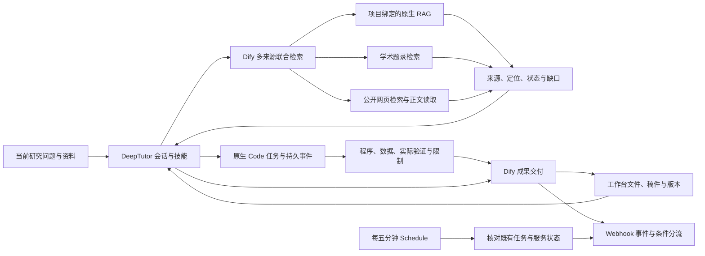

# DeepTutor 扩展工作流与高强度验收

更新：2026-11-01。日常入口为 [DeepTutor](https://tutor.example.invalid/)，项目文件、稿件、文献与版本位于 [研究工作台](https://tutor.example.invalid/research)。Dify 的五个流程按当前任务需要调用，研究课题、方法选择和结论沿用当前会话与作者决定。

## 现在看哪张画布

| 流程 | 已实现的业务步骤 | 入口 |
| --- | --- | --- |
| 多来源联合检索 | 当前项目请求 → RAG、网页、论文三个独立并行分支 → 合流与来源去重 → 完整/部分返回分支 | [打开画布](https://tutor.example.invalid/dify/app/643e80d5-4c8e-4449-a692-816f8fea221d/workflow) |
| 网页证据读取 | 已知公开链接 → 内置 WebScraper → 来源、正文、时间与截断标记 | [打开画布](https://tutor.example.invalid/dify/app/2f0d0b10-0d03-4a92-89b5-f8f07a51769a/workflow) |
| 研究成果交付 | 会话请求 → 项目、技能与版本校验 → 保存并回读 → 原生处理记录核验 → 回执 | [打开画布](https://tutor.example.invalid/dify/app/5c9d68ae-3847-4774-8e94-ecbfa9543e25/workflow) |
| 交付事件自动处理 | 原生 Webhook → 读取持久事件 → IfElse → 登记成功或异常与恢复动作 | [打开画布](https://tutor.example.invalid/dify/app/587c5e8f-5df8-4b54-866d-598a582dccb4/workflow) |
| 交付协调与健康检查 | 原生 Schedule，每五分钟 → 核对已有任务、遗漏事件和服务状态 → 正常/需处理分支 | [打开画布](https://tutor.example.invalid/dify/app/185575c4-6eda-4f00-b01b-0b0f7093c018/workflow) |

原来的六步画布是“成果交付”子流程。检索与事件处理现在有各自的真实可执行画布。

## skill、MCP、Agent 如何配合

DeepTutor 读取当前项目规范、任务技能原文和现有版本，负责讨论、证据取舍与委派。Code 继续使用真实 `tutor_deepcode 0.2.1` 原生适配器，保留会话、分支、命令去重、结构化事件、等待用户输入和产物读取。工作台管理共享证据与成果。Dify 显示业务阶段、并行来源、分支和触发来源，并返回真实运行记录。

当前 MCP 实际发现 41 个工具；联合检索和交付使用有明确边界的专用工具。其余原生文件、稿件、图表、汇报、阅读、下载和知识库工具保留现有接口。工具发现成功与全部操作都经过新一轮实测是不同的结论。

Tutor 的 `research_workbench` 支持：

- `context`：当前项目规范、技能与版本。
- `search`：单路网页、论文、网页正文或来源配置。
- `evidence`：按需并行查询 `knowledge / web / papers`。
- `evidence_status`：按原检索编号回读已保存结果。
- `deliver / status`：交付或查询同一成果。
- `activity`：当前项目近期交付、事件回调与服务检查。

研究方案、稿件主张和结论的确认沿用 Tutor 与工作台中的作者入口。Code 返回 `waiting_input` 时保留真实问题与任务编号。Dify 官方文档明确，Trigger 工作流不能使用 Web App Human Input 的表单投递；当前事件流程因此通过已有入口交接作者判断。技术故障的确认处理说明不等于批准科学结论。

## 这轮修正的实际问题

1. **首次知识库绑定被错误拒绝。** 原接口用“工作区已绑定资源”检查新增资源，造成循环限制。现在从当前账户可见资源库选择，再由原生资源注册接口核对权限。独立验证项目已合法绑定一个现有库；没有复制或重建源索引。
2. **工作台健康检查误报。** 镜像探针访问默认 `8001/health/ready`，实际工作台监听 `47900/health`。已修正探针，保留原运行参数；当前工作台为 healthy。
3. **来源失败被误作空结果或破坏整轮结果。** 现在区分 `ok / empty / failed / timed_out / not_configured / partial`，检查 HTTP 200 内的业务错误与非法结构。单路失败保留其他来源。
4. **去重吞掉同文不同段落。** 现在比较完整片段与定位；相同来源记录合并时保留每一路 provenance。
5. **公共搜索并发波动。** 免费 DDGS 聚合检索按来源串行，快速引擎失败只重试一次；限流不密集重试。成功结果缓存两分钟，失败不缓存。返回实际聚合检索来源，不将其统一冒充某一家搜索引擎。
6. **回调受理与完成混淆。** Webhook 202 只记为 dispatched。原始事件持久化，实际条件分支回调后才记为 completed；重复和乱序事件可核对。
7. **断连后缺少 Dify 运行身份。** Dify 在项目校验及检索节点通过原生系统变量主动登记运行编号。终态响应丢失后，定时协调查询原运行；已有文件不自动重复写入。

## 验证结果与可据此得出的结论

### 回归与故障注入

最终测试数字以 `reports/harness-acceptance.json` 为准。测试覆盖项目与账户权限、知识库绑定、来源选择、并发预算、超时、断连、401/403/429/5xx、HTTP 200 内的失败、非法响应、空结果、重复事件、乱序回调、重启持久化、版本冲突与写入回读。

联合检索测试由真实 `EvidenceService.branch`、解析、合并和 SQLite 持久逻辑产生回执，网络边界使用 MockTransport 注入故障。真实 FastMCP 运行时另行验证工具错误语义；不会用一个 HTTP 200 代替工具成功。

### 两轮真实查询负载

两轮使用同一组 20 个中英文查询，最多三个检索流程并发；包括三路联合、仅知识库、仅网页、明确 Scholar 和 Crossref。范围是连接、状态与证据来源验收，没有把非空结果算作语义正确率。

| 指标 | 调整公共来源前 | 调整后 |
| --- | ---: | ---: |
| 完整返回 | 15 | 18 |
| 部分返回 | 5 | 1 |
| 本轮所选来源全部不可用 | 0 | 1 |
| 全部完成耗时 | 96.9 s | 87.9 s |
| 单组中位数 | 12.8 s | 12.4 s |
| 单组 P95 | 32.9 s | 20.9 s |

上述失败均来自免费公共网页来源。调整后仍有失败，不能将短时改善写成长期可用性保证。三路任务的一路失败会标明缺口；仅选网页来源且失败时会准确返回 unavailable。

另一次 `limit=10` 的实际联合请求返回 26 条来源记录，约 7.8 秒。合流节点只传递覆盖与状态摘要，完整证据在适配器持久记录中保留，避免重复拼接大段原文挤占节点输出上限。

### 真实 Tutor、Code 与工作台交付

真实 Tutor 会话调用 `coder_run` 编写并运行 32 单元、100 步的一维无通量扩散算例。Code 完成退出码为 0；稳定命令身份重放两次复用同一任务，改载荷返回 409；71 条事件与持久序列一致，游标续读吻合。

从文件 API 回读实际程序后，在干净目录独立重跑，并用另一份守恒面通量实现核对：最终场最大绝对差 `2.220446049250313e-16`，离散质量误差 `0.0`，常量场变化 `0.0`，稳定性数 `0.2`。真实程序、结果 JSON 和 Code 自报记录已分别经 Dify 保存到验证工作台；独立验证与 Code 自报验证分开记录。此算例验证软件链路及指定数值不变量。

另一个真实 Tutor 会话自主调用 `evidence → context → deliver`，取得 RAG 和 Scholar 结果，将实际检索编号、coverage、警告与限制写入项目文件，并取得真实保存回执。完整会话链接见 `reports/harness-agent-live.json`。

### 停顿、重启与画布

在独立验证项目中，实际暂停 Dify 触发工作进程、保存成果、重启适配器，再恢复工作进程；核对已有成果、检索结果、持久队列、唯一原生回执与唯一事件。测试始终在 finally 恢复工作进程。

五张真实画布通过隔离浏览器登录、节点显示、资源请求、脚本错误及内置检查清单验收。修正了 Webhook 展示参数、变量声明、互斥输出重名和说明卡布局。截图保存在 `reports/screenshots/`。

## 使用与维护

日常继续在原项目会话中工作。需要多来源证据时调用联合检索；有待保存成果时交付；长 Code 任务按原 task_id 续读。查看故障先沿同一 `run_id / workflow_run_id / task_id` 查询，保留原始输出。

部署入口为 `ops/optimize_workflow.py`、`ops/setup_evidence.py`、`ops/setup_automation.py` 与 `ops/setup_web_reader.py`。当前发布流程、密钥权限与原生扩展均应保留。密钥只存 private 目录，通过只读挂载供服务读取。

作者确认与外部 Scholar 人工验证仍需要相应的人类操作。Tavily、SerpApi、Jina 等未配置来源没有被伪装成已经可用。PPT 导出、论文下载、图表编辑等保留工具未在这轮逐项跑完全部变体；本轮完整验收范围是取证、原生 Code、成果保存与事件恢复链。

第一方研究依据与访问范围见 [Deep Research 工程复核](deep-research-engineering-review.md) 和 [现有接口审计](integration-capability-audit.md)。
