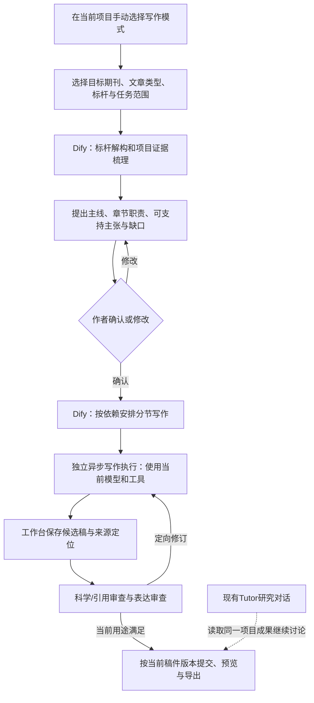

# 独立写作模式接入 Dify 的评估与待确认方案

评估日期：2026年11月3日。状态：方案待作者确认，未部署写作模式，未修改现有Tutor内核或原有Dify流程。

评估材料为作者提供的 `C:/Users/DEVELOPER/Desktop/1111.pdf`，共19页。本次逐页视觉阅读了全文，页码摘要保存在 `reports/writing-workflow-evaluation/1111-reading-notes.md`。另检查了生产DeepTutor扩展协议、现有Dify桥接、稿件与评审实现、Dify 1.18.0运行设置及官方文档。

## 判断

可以接入，而且与当前产品架构相容。建议把材料中的标杆解构、项目证据组织、分节写作和独立审查做成按需启动的写作模式，由Dify管理阶段与分支。模型生成由独立异步写作任务承担，沿用当前账户选择的模型与现有工具；项目原件、当前稿件和修改记录继续由工作台管理。

价值来自明确每段承担的论证任务、把主张连回证据、让全文与局部修订接续、把作者的科学判断放在适当位置。五个Agent只是五项职责；是否分别运行、是否需要工具循环由该阶段任务决定，不必把五个自由探索的长对话串起来。

文档提出“100%通用”和由标杆归纳“期刊基因”，证据不足。标杆样本适合提供可供选择的结构和表达经验；其事实、科学定位、贡献等级和负面评价不能变成新项目的默认结论。该设计可跨主题复用，但需要按论文类型、研究成熟度、资料和期刊要求调整。

## 应保留和应修改的内容

| PDF中的设计及页码 | 建议 | 理由与具体变化 |
| --- | --- | --- |
| 两轨材料：标杆与项目资产，2—3页 | 保留材料角色，复用现有文献库 | 在同一库中按角色及权限筛选，标杆可同时作为事实来源，但借鉴写法和支持主张分别记录；避免复制两套全文和索引。 |
| L3/L2/L1，4—6页 | 保留信息分层，作为写作模块自己的状态 | L3是有来源和版本的期刊/类型写作参考；L2是作者确认的论证与证据记录；L1是分节进度及邻段上下文。它们不替换Tutor原生记忆层。 |
| 方法/结果先行，1—2、11—13页 | 对已有结果的研究论文采用；允许按指定章节进入 | 没有结果时仍可写已获支持的研究现状和方案，受影响的结果主张等待证据。单节修订沿用已确认主线，避免每次从头规划全文。 |
| 五个Agent，8—14页 | 实现为职责明确的阶段 | 提取、规划、起草可使用同一模型但独立阶段上下文；审查单独调用。需要读工具时才使用Agent循环，稳定结构化任务可直接生成和校验。 |
| 科学严谨度与比较指标，7—8页 | 连接真实程序和已有验证结果 | MCP名称不等于已有实现。数值记录必须带数据位置、单位、定义、比较基线、条件和实际计算回执；按研究类型决定适用检查，允许“不适用”和“未知”。 |
| 期刊表达借鉴，3—5、13—14页 | 保留带出处的表达及结构归纳 | 保存原文位置和适用论证功能，用项目自己的证据写作；不照搬长段、不为追求语感强化因果、优越性或新颖性。 |
| 唯一主线与“新方法×旧问题”，5、10页 | 改成供作者选择的候选论证 | 允许机制研究、验证研究、应用、综述或否定结果；科学目标、承诺和漏斗结构由作者确认后进入起草。已有确认可复用，资料变化影响主张时才重新确认。 |
| 缺证据直接终止，17页 | 只暂停依赖该证据的主张或章节 | 输出缺口及已有可写范围；不发明证据，也不让一个局部缺口阻止全文所有工作。 |
| 审查/改写循环，19页 | 修改后重新审查同一新版本 | 原代码用改写前的diagnostics验收改写后的稿件，存在版本错误。风格修改与科学审查使用不同上下文，评审不能靠起草模型自报all_assertions_passed。复用现有阶段评审规则及定向修订次数。 |
| Python“执行代码”，15—19页 | 仅作为伪代码设计参考 | 依赖对象、工具实现、运行入口、异常恢复和引用一致性尚缺。代码的L1只取整节末400字符，无法兑现段落缓冲；execute也丢掉未通过审查的状态。 |

L3缓存还需包含标杆集合及版本、指南版本、文章类型、语言、规则版本和访问范围。文档的journal_id+theme不足以判断能否复用。期刊指南中的明文要求与样本归纳的经验应分别保存。

## 现有实现能复用什么

1. DeepTutor生产协议中已有`LoopExtension`：通过`is_active(context)`按轮启用，贡献`system_block`、专用工具和服务器绑定的参数；现有`research_workbench`已通过`deeptutor.tools`与`deeptutor.extensions`入口接入。普通对话无需加载写作提示或启动写作任务。
2. 当前工作台已有真实项目、原文/派生阅读本、参考文献、稿件revision、批注和导出。写作任务读取这些对象的版本与定位，保存仍走既有接口。Dify运行变量不成为第二份当前稿件。
3. 已有`writing`与`review`阶段评审；当前规则将模型评价与程序检查分开，并把评审绑定到产物和来源版本。可加入写作特定问题定位，复用其保存/回读和失效机制。
4. 现有Dify检索、交付、事件和状态桥接可复用身份与恢复方式。新增独立写作应用和命名空间；不覆盖已有五张流程图或更改普通Tutor的Agent循环。

仍需实现：写作模式入口与任务状态、标杆结构化提取及角色标签、可回查的主张—证据记录、作者确认接续、分节起草与合并、对新版本的独立复查，以及无生成超时的异步执行适配。现有代码和接口只是可复用基础，不代表这套写作流程已经存在。

## 推荐的用户流程

日常界面仍在当前项目。模式中展示实际阶段、当前章节、已完成段落、等待原因和可回读产物；用户可暂停、继续或回到研究对话。模式切换本身不自动取消正在执行的任务；暂停和取消有明确操作。

开始写作时默认提出主线、关键主张与章节分工供作者一次确认。全文承诺改变、证据推翻主张时再询问；普通句段修改直接完成。标杆可由Agent先给出有理由的候选，保留作者选择。已确认稿件的局部修订复用原决定。

原稿通过版本化接口保留；候选内容先在同一稿件任务中可比较和回查，再按当前revision提交。无需堆积多份final/v2文件。最终回执分别说明保存状态、审查发现和证据范围，不把评分通过等同于科学真值。

## Dify的适配与超时问题

Dify的LLM节点支持结构化输出，Iteration适合逐篇标杆处理，Loop适合依赖上一稿的修订。Human Input支持暂停、提交表单与接续事件；已在生产1.18.0代码中核验相应Service API路由。界面应将作者确认接回现有Tutor/工作台，用户不必另开Dify后台。

生产运行设置实检：`WORKFLOW_MAX_EXECUTION_TIME=3600`、`WORKFLOW_MAX_EXECUTION_STEPS=500`、`PLUGIN_DAEMON_TIMEOUT=600.0`。这些分别约束整次流程和插件请求，不等同于所有模型都会在600秒终止，但不能假设把生成挪入Dify后自然没有时限。工作台旧的通用模型转发还使用240秒HTTP调用，不能直接用于本次无固定生成期限的写作器。

因此推荐：Dify决定阶段和分支，发起异步写作任务后快速返回任务ID；耗时生成由独立写作执行模块完成，模型请求无本地固定时限，并支持取消和真实错误回执。完成事件或作者回复再触发下一阶段的Dify运行。持久`writing_run_id`关联各阶段的Dify运行号、稿件revision、来源版本和任务号；Dify不在一个执行中持续轮询等待整个论文。这样不需要调整全站Dify时限，也不把长生成或数日作者等待放在单次工作流中。

作者确认优先复用工作台已有入口和持久状态。若采用Dify原生Human Input表单，表单有自己的有效期；过期只能表示等待状态变化，不得解释为作者同意，也不得使已有写作成果丢失。具体交互需要实施时按1.18.0接口验证。

## 首版实施范围与验收

建议首版打通完整研究论文和指定章节的同一工作流：手动模式入口、标杆解构、证据/论证确认、分节起草、独立审查、写回和导出。文章类型控制章节职责；不把PDF的五步摘要、三句展望、正文/附录规则强制应用到全部稿件。

验收使用一个真实研究项目：普通模式对照；标杆和证据均能回查；不凭空生成未做的结果；修改原数据后受影响主张提示失效；中断后接续同一写作任务；新稿审查不会沿用旧版本结论；模型可静默等待超过旧期限且用户可停止；真实稿件保存、引用和导出正确。

阶段角色可以逐步使用分工执行，但本次评估没有启动多个写作Agent，没有部署或运行试写，也没有改变既有模型选择。可行性来自文档、协议与现有实现检查，写作质量收益仍需用真实稿件比较验证。

## 待作者确认的具体提议

建议按“Dify分阶段编排＋独立异步写作模块＋现有工作台资料与稿件”实施；只在手动写作模式激活；默认沿用当前账户模型，复用独立评审设置；保留标杆解构和证据驱动写作，修正文档的固定模板与自报验收问题；主线和章节方案先确认，然后连续起草和定向修订。

本次按用户“评估并向我确认”的要求停在方案，不发布新应用或修改生产流程。需要确认的是这条具体接入路线及首版范围。

## 核验来源

- 作者PDF第1—19页，逐页视觉阅读；阅读定位见本报告开头。
- 实际生产`/app/deeptutor/capabilities/protocol.py`、`capabilities/registry.py`及现有`dify_delivery.py`扩展。
- 工作台`server/models.py`、`review_transport.py`、`quality_api.py`、`stage_reviews.py`；本地源码与生产运行设置分别检查。
- [Dify LLM节点](https://docs.dify.ai/en/self-host/use-dify/nodes/llm)：模型调用、上下文与结构化输出。
- [Dify Iteration节点](https://docs.dify.ai/en/self-host/use-dify/nodes/iteration)与[Loop节点](https://docs.dify.ai/en/use-dify/nodes/loop)：独立项处理与依赖式修订的区别。
- [Dify Human Input API流程](https://docs.dify.ai/en/api-reference/guides/human-input-flow)：身份、表单、暂停、提交与事件接续。
- [Dify 1.18.0 Human Input源码](https://github.com/langgenius/dify/blob/1.18.0/api/controllers/service_api/app/human_input_form.py)及[同版本配置源码](https://github.com/langgenius/dify/blob/1.18.0/api/configs/feature/__init__.py)：与当前部署版本对照。
